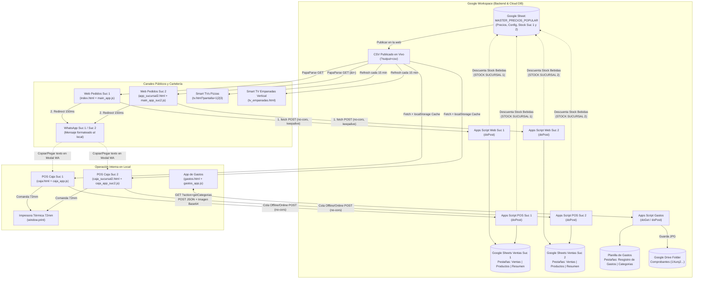

# Documentación Técnica y Funcional Exhaustiva — Ecosistema "Pizzería Popular"

> **📌 Regla de Oro para Desarrolladores y Asistentes de IA:**
> Este archivo constituye la fuente única de verdad (*Single Source of Truth*) y el "cerebro" documental del proyecto **Pizzería Popular** (Sucursal 1 y Sucursal 2). Cualquier desarrollador o IA que trabaje sobre el repositorio debe leer este documento antes de modificar código. **Si se detecta un error, se resuelve un problema específico de lógica de negocio o el usuario (Nicolás) corrige o enseña algo nuevo sobre la operatoria de la pizzería o del sistema, es OBLIGATORIO actualizar este documento (`CONTEXTO_PIZZERIA.md` y `contexto_pizzeria.md`) para preservar el conocimiento.**

---

## Índice General
1. [Visión General y Arquitectura del Ecosistema](#1-visión-general-y-arquitectura-del-ecosistema)
2. [Estructura Completa de Carpetas y Función de Cada Archivo](#2-estructura-completa-de-carpetas-y-función-de-cada-archivo)
3. [Flujo de Datos Integral (POS, Web WhatsApp, TVs, Gastos y Google Sheets)](#3-flujo-de-datos-integral-pos-web-whatsapp-tvs-gastos-y-google-sheets)
4. [Estructura Exacta de Columnas, Endpoints de Apps Script y CSV Publicados](#4-estructura-exacta-de-columnas-endpoints-de-apps-script-y-csv-publicados)
5. [Reglas de Negocio Detalladas](#5-reglas-de-negocio-detalladas)
6. [Diferencias Exactas en Código entre Sucursal 1 y Sucursal 2](#6-diferencias-exactas-en-código-entre-sucursal-1-y-sucursal-2)
7. [Historial de Decisiones Técnicas, Aprendizajes y Roadmap](#7-historial-de-decisiones-técnicas-aprendizajes-y-roadmap)

---

## 1. Visión General y Arquitectura del Ecosistema

**Pizzería Popular** opera dos sucursales en la ciudad de **La Plata, Provincia de Buenos Aires, Argentina**:
* **Sucursal 1 (Casa Central):** Calle 6 esquina 66, La Plata.
* **Sucursal 2:** Diagonal 76 (entre 18 y 43), La Plata.

El ecosistema de software sigue una arquitectura **Serverless / Jamstack descentralizada**, sin servidores dedicados ni bases de datos relacionales tradicionales:
* **Hosting Frontend:** Estático (GitHub Pages bajo el dominio oficial `pizzeriapopular.ar`), construido en **HTML5, CSS3 y Vanilla JavaScript (ES6+)** sin frameworks pesados para maximizar velocidad de carga y resiliencia offline en los puntos de venta.
* **Base de Datos de Catálogo y Precios (`MASTER_PRECIOS_POPULAR`):** Una hoja de cálculo centralizada en Google Sheets publicada en la web como CSV, consumida en tiempo real por las tiendas online, los sistemas POS de caja y los televisores de cartelería digital mediante `PapaParse`.
* **Backend Transaccional y Almacenamiento (`Google Apps Script` + `Google Sheets` + `Google Drive`):** Web Apps de Google Apps Script que reciben peticiones HTTP `POST` y `GET` para:
  1. Registrar ventas generales y desglose unitario de productos vendidos (para métricas y control de insumos).
  2. Descontar stock en tiempo real sobre el archivo `MASTER_PRECIOS_POPULAR`.
  3. Registrar gastos operativos diarios y almacenar fotos comprimidas de comprobantes en Google Drive.

---

## 2. Estructura Completa de Carpetas y Función de Cada Archivo

### 2.1. Árbol Completo del Repositorio

```text
popular-menu-main/
├── CNAME                                         # Dominio personalizado para GitHub Pages (pizzeriapopular.ar)
├── package.json                                  # Dependencias Node locales (papaparse ^5.5.4)
├── package-lock.json                             # Lockfile de npm
├── test.js                                       # Script Node de diagnóstico para inspeccionar el CSV remoto
├── .directory                                    # Configuración visual de carpeta en entorno Linux (Icon=folder-yellow)
├── CONTEXTO_PIZZERIA.md                          # Documentación técnica y funcional exhaustiva del ecosistema
├── contexto_pizzeria.md                          # Resumen base original de reglas de oro y aprendizajes
│
├── Pizzeria_Popular_1.png                        # Logo circular principal (usado en Web de Pedidos y Favicon)
├── logo_nuevo.png                                # Logo en alta resolución (usado en las Carteleras Digitales de TV)
│
├── index.html                                    # [WEB PEDIDOS - SUC 1] Tienda online para clientes (Calle 6 esq. 66)
├── main_app.js                                   # [WEB PEDIDOS - SUC 1] Lógica de catálogo, carrito, docenas y checkout WA
├── app_styles.css                                # [WEB PEDIDOS - SUC 1] Estilos de la tienda online Sucursal 1
│
├── app_sucursal2.html                            # [WEB PEDIDOS - SUC 2] Tienda online para clientes (Diagonal 76 e/ 18 y 43)
├── main_app_suc2.js                              # [WEB PEDIDOS - SUC 2] Lógica de catálogo, carrito, docenas y checkout WA
├── app_styles_suc2.css                           # [WEB PEDIDOS - SUC 2] Estilos de la tienda online Sucursal 2
│
├── caja.html                                     # [POS CAJA - SUC 1] Interfaz Punto de Venta mostrador/teléfono (6 y 66)
├── caja_app.js                                   # [POS CAJA - SUC 1] Lógica POS, login SHA-256, cola offline, impresión 72mm
├── caja_styles.css                               # [POS CAJA - SUC 1] Estilos POS y reglas @media print para comandera térmica
│
├── caja_sucursal2.html                           # [POS CAJA - SUC 2] Interfaz Punto de Venta mostrador/teléfono (Sucursal 2)
├── caja_app_suc2.js                              # [POS CAJA - SUC 2] Lógica POS, login SHA-256, cola offline, impresión 72mm
├── caja_styles_suc2.css                          # [POS CAJA - SUC 2] Estilos POS y reglas @media print para comandera térmica
│
├── codigo_apps_script.js                         # [BACKEND VENTAS/STOCK] Google Apps Script (doPost: Ventas, Productos, Stock)
│
├── tv.html                                       # [CARTELERA TV PIZZAS] Pantalla horizontal 1920x1080 (P/Hornear y Horneadas)
├── tv_app.js                                     # [CARTELERA TV PIZZAS] Lógica multipantalla (?pantalla=1|2|3), auto-escala y sync
├── tv_styles.css                                 # [CARTELERA TV PIZZAS] Estilos Full HD horizontal sin scroll
│
├── tv_empanadas.html                             # [CARTELERA TV EMPANADAS] Pantalla vertical 1080x1920 (Clásicas, Premium, Fatay)
├── tv_empanadas_app.js                           # [CARTELERA TV EMPANADAS] Lógica de precios por bloque, Promo Docena y auto-escala
├── tv_empanadas_styles.css                       # [CARTELERA TV EMPANADAS] Estilos Portrait 1080x1920 para Smart TV Samsung
│
├── gastos.html                                   # [MÓDULO GASTOS] App web mobile-first para carga de egresos y comprobantes
├── gastos_app.js                                 # [MÓDULO GASTOS] Fetch de categorías, compresión Canvas JPEG 70% y envío Base64
├── gastos_styles.css                             # [MÓDULO GASTOS] Estilos oscuros mobile-friendly y adaptación de SweetAlert2
├── gastos_apps_script.js                         # [BACKEND GASTOS] Google Apps Script (doGet categorías, doPost Drive + Sheets)
├── Planilla de Gastos - Resgistro de Gastos.csv  # [DATOS MUESTRA] Exportación CSV histórica real de la hoja de gastos
│
└── node_modules/
    └── papaparse/                                # Librería PapaParse instalada localmente para scripts de consola
```

---

### 2.2. Función Detallada de Cada Archivo

#### A. Infraestructura, Dominio y Utilidades
1. **`CNAME`** (1 línea):
   * Contiene exactamente `pizzeriapopular.ar`. Vincula el repositorio en GitHub Pages con el dominio oficial argentino de la marca.
2. **`package.json` y `package-lock.json`**:
   * Declaran la dependencia `"papaparse": "^5.5.4"` para entorno local Node. En los archivos HTML de producción, PapaParse se consume vía CDN (`https://cdnjs.cloudflare.com/ajax/libs/PapaParse/5.3.2/papaparse.min.js`).
3. **`test.js`** (9 líneas):
   * Script utilitario en Node.js que descarga mediante `fetch()` el CSV publicado del Master de Precios, imprime la primera línea (`HEADERS`) y busca la fila que contenga `"jamon"` o `"jamón"` para verificar conectividad y estructura de columnas.
4. **`Pizzeria_Popular_1.png` (836 KB) y `logo_nuevo.png` (5.2 MB)**:
   * Recursos gráficos de identidad visual. `Pizzeria_Popular_1.png` se utiliza en los headers y favicons de `index.html` y `app_sucursal2.html`; `logo_nuevo.png` se utiliza en `tv.html` y `tv_empanadas.html`.

#### B. Módulo 1: Web Pública de Pedidos por WhatsApp (`index.html`, `app_sucursal2.html`, `main_app.js`, `main_app_suc2.js`, `app_styles.css`, `app_styles_suc2.css`)
1. **`index.html`** (195 líneas — Sucursal 1) y **`app_sucursal2.html`** (195 líneas — Sucursal 2):
   * **Header informativo:** Incluye `#status-badge` (indicador en vivo de `"🟢 ABIERTO AHORA"` o `"🔴 CERRADO"`), logo circular, título de la sucursal, dirección (`6 esquina 66 La Plata` en Sucursal 1; `Diagonal 76 (18 y 43) La Plata` en Sucursal 2), horario (`Mar a Dom: 19:00hs a 23:00hs`) y botones sociales de WhatsApp e Instagram (`@pizzeriapopular`).
   * **Navegación Sticky (`.sticky-nav`):** Barra flotante con accesos rápidos por ancla a `#empanadas`, `#fatays`, `#pizzas`, `#promos`, `#medias-pizzas` y `#bebidas`.
   * **Contenedores de Catálogo (`<main class="menu-container">`):** Aloja los nodos DOM donde se inyectan los productos: `#empanadas-clasicas-list`, `#empanadas-premium-list`, `#fatays-list`, `#pizzas-list`, `#promos-list`, `#medias-pizzas-list` y `#bebidas-unificadas-list`.
   * **Botón Flotante de Carrito (`#cart-btn`):** Permanece oculto mientras el carrito está vacío; al agregar productos aparece con animación pulsante verde WhatsApp mostrando el contador `#cart-count`.
   * **Modal de Carrito y Checkout (`#cart-modal`):** Panel lateral derecho con el listado de ítems (`#cart-items`), totalizador (`#cart-total`) y formulario HTML5 (`#checkout-form`) con validación nativa (`required`):
     * `#cli-nombre` (Nombre y Apellido)
     * `#cli-telefono` (Teléfono de contacto)
     * `#cli-entrega` (`delivery` = Envío a Domicilio / `retiro` = Retiro por el Local)
     * `#delivery-fields` (se oculta si elige Retiro): `#cli-direccion` (Calle y Número), `#cli-entrecalles` (Entre Calles) y `#cli-depto` (Depto / Piso, opcional)
     * `#cli-horario` (`Lo antes posible` / `Programado`, que despliega `#cli-horario-exacto` `<input type="time">`)
     * `#cli-pago` (`Efectivo`, que despliega `#cli-abona` *"¿Con cuánto abonás?"* / `Transferencia`, que despliega `#info-transferencia` mostrando `#display-alias`)
     * `#cli-notas` (Aclaraciones para la cocina, opcional)
     * `#btn-submit-order` (*"Enviar Pedido por WhatsApp"*)
   * **Modal "Armá tu Docena" (`#docena-modal`):** Modal superpuesto (`z-index: 1001`) con contador `Llevás: X / 12` (`#docena-count`), precio dinámico (`#docena-total-price`), contenedor scrollable de sabores separados en Clásicas y Premium (`#docena-flavors-container`) y botón `#btn-confirm-docena` (deshabilitado hasta alcanzar exactamente 12 unidades).
2. **`main_app.js`** (633 líneas — Sucursal 1) y **`main_app_suc2.js`** (641 líneas — Sucursal 2):
   * Definen la clase `PizzeriaApp` e inicializan `window.AppPublica` en `DOMContentLoaded`.
   * Descargan y parsean el CSV remoto con `Papa.parse()`, filtran productos por sucursal y stock de empanadas, extraen parámetros de configuración (`ENVIO`, `ALIAS` / `ALIAS SUCURSAL 2`), construyen el DOM de forma segura (`textContent` / `sanitize()`), administran el estado del carrito y de las docenas personalizadas, formatean el mensaje de texto de WhatsApp, desglosan las promociones para las métricas del Excel, disparan el `fetch()` de registro hacia Google Apps Script con `mode: 'no-cors'` y `keepalive: true`, y redirigen a `https://api.whatsapp.com/send` tras `150ms`.
3. **`app_styles.css`** (82 líneas) y **`app_styles_suc2.css`** (82 líneas):
   * Hojas de estilo idénticas. Definen la paleta (`--bg-body: #0f0f0f`, `--primary: #FFC107`, `--accent: #FF3D00`, `--white: #ffffff`), tipografías `Oswald` (títulos, precios y botones) y `Roboto` (cuerpo e inputs), tarjetas traslúcidas con `backdrop-filter: blur(10px)`, controles `.stepper` y diseño responsive.

#### C. Módulo 2: Punto de Venta / Caja Local (`caja.html`, `caja_sucursal2.html`, `caja_app.js`, `caja_app_suc2.js`, `caja_styles.css`, `caja_styles_suc2.css`)
1. **`caja.html`** (176 líneas — Sucursal 1) y **`caja_sucursal2.html`** (176 líneas — Sucursal 2):
   * **Pantalla de Bloqueo (`#bloqueo`):** Overlay a pantalla completa (`z-index: 9999`) que solicita contraseña en `#pass` antes de mostrar `#app-caja`.
   * **Panel Izquierdo (`.panel-menu`):**
     * Header con título de sucursal, indicador de estado de red/sincronización (`#sync-status-indicator` con estados `Sincronizado`, `Pendientes: X` u `Offline`), botón `#btn-modal-wa` (*"Imprimir WA"*) y botón `#btn-historial` (*"Últimos Tickets"*).
     * Buscador instantáneo `#buscador-productos` por nombre, variante o descripción.
     * Barra de 9 filtros de categoría (`#contenedor-filtros`): `PIZZAS_HORNEADAS`, `PIZZAS_HORNEAR`, `EMPANADAS`, `FATAYS`, `PROMOS`, `BEBIDAS`, `MEDIAS_HORNEADAS`, `MEDIAS_HORNEAR`, `EXTRAS`.
     * Grilla de botones de productos (`#grid-productos`).
   * **Panel Derecho (`.panel-ticket`):**
     * Encabezado con switch `#toggle-autodocena` (marcado por defecto).
     * Lista de ítems del carrito (`#cart-items`).
     * Sección de cobro (`.seccion-cobro`): botón `#btn-abrir-descuento`, input numérico editable `#total-display` (permite redondeo o ajuste manual directo del total), 3 botones `.btn-pago` (`Efectivo`, `Transferencia`, `Deb/Cred`), calculadora de vuelto (`#paga-con` y `#display-vuelto`), selector de modalidad (`#btn-tipo-mostrador` / `#btn-tipo-delivery`), campo `#input-cliente`, bloque desplegable `#datos-delivery` (`#input-telefono`, `#input-calle`, `#input-numero`, `#input-entre-calles`, `#input-depto`, `#input-envio`) y botón `#btn-cobrar` (*"COBRAR E IMPRIMIR"*).
   * **Modales y Utilidades:** `#modal-docena` (armado manual de docena), `#desc-modal` (descuento por `% Porcentaje` o `$ Monto Fijo`), `#historial-modal` (lista de los últimos 50 tickets guardados en `localStorage` con opción de reimprimir o limpiar), `#wa-modal` (textarea para pegar el texto de un pedido de WhatsApp e imprimir su comanda), `#ticket-impresion` (contenedor exclusivo para `@media print`) y `#toast`.
2. **`caja_app.js`** (894 líneas — Sucursal 1) y **`caja_app_suc2.js`** (894 líneas — Sucursal 2):
   * Implementan la clase `PizzeriaPOS` (`window.AppCaja`).
   * Gestionan el login por hash SHA-256 (`1650`), la descarga del CSV con respaldo offline en `localStorage` (`menuPizzeria`), el desdoblamiento de cada pizza y media pizza en dos botones independientes (`Horneada` con `PRECIO_2` y `Para Hornear` con `PRECIO_1`), la validación y descuento en memoria del stock de `BEBIDAS`, la agrupación automática de 12 empanadas sueltas en `PROMO DOCENA` (`autoEmp()`), la generación del HTML de ticket térmico, el disparo de `window.print()`, y la cola persistente de sincronización de ventas (`ventasPendientesOffline`).
3. **`caja_styles.css`** (107 líneas) y **`caja_styles_suc2.css`** (107 líneas):
   * Hojas de estilo idénticas. Definen el layout POS de doble columna sin scroll global (`height: 100vh; overflow: hidden`) pero con scroll interno en `.panel-menu` y `.panel-ticket` (solucionando el solapamiento cuando se despliegan los campos de Delivery), los indicadores `.sync-ok` / `.sync-error`, `.stock-badge` / `.stock-low`, y el bloque `@media print` optimizado para impresoras térmicas de 72mm.

#### D. Módulo 3: Cartelería Digital / Pantallas KDS de TV (`tv.html`, `tv_app.js`, `tv_styles.css`, `tv_empanadas.html`, `tv_empanadas_app.js`, `tv_empanadas_styles.css`)
1. **`tv.html` (51 líneas), `tv_app.js` (179 líneas) y `tv_styles.css` (160 líneas) — Cartelera Horizontal de Pizzas (`1920x1080`):**
   * Diseñada para 3 televisores horizontales en el local, controlados mediante el query param `?pantalla=1`, `?pantalla=2` o `?pantalla=3` (por defecto `"1"`):
     * **Pantalla 1 (`?pantalla=1`):** Muzzarella, Especial, Fugazzeta, Fugazzetta con Jamón (visual: *Fugazeta con Jamon*), Napolitana, Napo con Huevo (visual: *Napolitana con Huevo*), Napo con Jamón (visual: *Napolitana con Jamon*), Roquefort, Roque y Cebolla (visual: *Roquefort y Cebolla*), Roque y Jamón (visual: *Roquefort y Jamon*).
     * **Pantalla 2 (`?pantalla=2`):** Verdura, Panceta, Panceta y Huevo, Panceta y Roque (visual: *Panceta y Roquefort*), Primavera, Longaniza, Ananá, Hot Dog, Palmitos.
     * **Pantalla 3 (`?pantalla=3`):** Jamón Crudo, Jamón Crudo y Rúcula, Champignon, Champi y Jamón (visual: *Champignon con Jamon*), Popular, Cuatro Quesos (visual: *4 Quesos*), Pollo, Pollo y Roque (visual: *Pollo y Roquefort*), Choclo, Anchoas.
   * Muestra para cada pizza su precio `P/Hornear` (`PRECIO_1`) y `Horneadas` (`PRECIO_2`), y en el pie de página el cartel `🍕 HORNEADAS + $<extraHorneado>` extraído de la fila `SECCION = EXTRAS` y `NOMBRE = HORNEADO`.
   * Re-sincroniza precios automáticamente cada **15 minutos** (`15 * 60 * 1000` ms) y aplica `transform: scale(...)` dinámico en `ajustarEscala()` para encajar exactamente en cualquier monitor sin barras de desplazamiento.
2. **`tv_empanadas.html` (63 líneas), `tv_empanadas_app.js` (155 líneas) y `tv_empanadas_styles.css` (162 líneas) — Cartelera Vertical de Empanadas (`1080x1920`):**
   * Diseñada en formato vertical (Portrait `1080x1920`) específicamente para el Smart TV Samsung vertical del local.
   * Lee del CSV las secciones `EMPANADAS_CLASICAS`, `EMPANADAS_PREMIUM` y `FATAYS`, toma el primer precio válido (`PRECIO_1`) de cada sección para mostrarlo en el badge amarillo junto al título (`#price-clasicas`, `#price-especiales`, `#price-fatay`), renderiza los sabores en grillas de 2 columnas (1 columna centrada para Fatay) y destaca en el footer la tarjeta roja/amarilla `🔥 PROMO DOCENA` con su precio.
   * Se auto-actualiza cada **15 minutos** y auto-escala proporcionalmente a la pantalla.

#### E. Módulo 4: Registro de Gastos y Comprobantes (`gastos.html`, `gastos_app.js`, `gastos_styles.css`, `gastos_apps_script.js`, `Planilla de Gastos - Resgistro de Gastos.csv`)
1. **`gastos.html` (86 líneas), `gastos_app.js` (226 líneas) y `gastos_styles.css` (221 líneas):**
   * Aplicación web móvil para cargar gastos operativos.
   * Al iniciar, consulta `GET ${SCRIPT_URL}?action=getCategorias` para poblar el `<select id="categoria">`.
   * Permite seleccionar fecha (por defecto hoy ajustado a huso horario local), descripción, monto (`step="0.01"`), categoría, medio de pago (`Transferencia` o `Efectivo`) y adjuntar foto del comprobante mediante dos botones independientes:
     * **Tomar Foto (`#comprobante-camara`):** `accept="image/*" capture="environment"` (abre directamente la cámara trasera del celular).
     * **Galería (`#comprobante-galeria`):** `accept="image/*"` (abre el explorador de archivos/galería).
   * Antes de subir, la función `comprimirImagen(file)` redimensiona la imagen en un `<canvas>` a un máximo de `1200x1200` píxeles manteniendo la relación de aspecto y la exporta como `image/jpeg` al **70% de calidad** (`canvas.toDataURL('image/jpeg', 0.7)`), reduciendo drásticamente el peso antes de enviarla en Base64 a Apps Script.
   * Si el usuario intenta guardar sin adjuntar foto, `SweetAlert2` muestra una confirmación (`"¿Guardar sin comprobante?"`).
2. **`gastos_apps_script.js`** (132 líneas):
   * Backend en Google Apps Script vinculado a la Planilla de Gastos.
   * `doGet(e)`: Si `e.parameter.action === 'getCategorias'`, lee desde `A2` hasta la última fila de la pestaña `"Categorias"` y devuelve `{ status: 'success', categorias: [...] }`.
   * `doPost(e)`: Recibe el JSON del gasto, decodifica `data.imageBase64`, crea el archivo `Comprobante_<fecha>_<monto>.jpg` en la carpeta de Google Drive `FOLDER_ID = '1Xurq2gvhBaw3TE9e3tm7fxGVng4HXH0y'`, obtiene su URL (`file.getUrl()`), convierte la fecha de `YYYY-MM-DD` a `DD/MM/YYYY`, convierte el monto a número real con `parseFloat(monto)` y agrega la fila en la pestaña `'Resgistro de Gastos'`.
3. **`Planilla de Gastos - Resgistro de Gastos.csv`** (180 líneas):
   * Copia CSV de respaldo con 179 gastos reales registrados entre el `1/3/2026` y el `18/4/2026` (incluyendo pagos de sueldos, alquileres de 6 y 66 y Diagonal 76, proveedores como Rama, Cidap, Abjorro, Olliari, verdulería, Edelap, Camuzzi, ABSA, nafta y retiros).

#### F. Módulo 5: Backend de Ventas y Stock en Google Apps Script (`codigo_apps_script.js`)
1. **`codigo_apps_script.js`** (131 líneas):
   * Script desplegado en las hojas de cálculo de ventas (`Ventas App Pizzería` y `Ventas Caja` de cada sucursal).
   * Su función `doPost(e)` procesa el payload JSON enviado tanto por la Web de Pedidos como por el POS de Caja:
     1. Genera un `orderId` único de 6 dígitos (`"#" + new Date().getTime().toString().slice(-6)`).
     2. Inserta el registro maestro del ticket en la pestaña **`Ventas`**.
     3. Recorre `data.carrito` e inserta el desglose ítem por ítem en la pestaña **`Productos`**, aplicando reglas de prioridad para clasificar Promos, Pizzas de Promo, Empanadas de Promo (separando los sabores por `|` y multiplicando cantidades), Promo Fatay, Pizzas, Bebidas, Fatays, Empanadas Sueltas y Extras.
     4. Abre el archivo maestro de precios (`SpreadsheetApp.openById(MASTER_SHEET_ID)`) y, para cada ítem detectado como bebida, busca la coincidencia exacta de `NOMBRE` y resta la cantidad vendida en la columna `STOCK SUCURSAL 1` (o `STOCK SUCURSAL 2`), impidiendo valores negativos (`if (nuevoStock < 0) nuevoStock = 0`).

---

## 3. Flujo de Datos Integral (POS, Web WhatsApp, TVs, Gastos y Google Sheets)

### 3.1. Diagrama de Arquitectura y Flujo de Datos



---

### 3.2. Paso a Paso de Cada Flujo Operativo

#### Flujo 1: Pedido Online de Cliente por Web + WhatsApp (`index.html` / `app_sucursal2.html`)
1. **Lectura de Catálogo en Vivo:** Al abrir la web, `cargarMenu()` descarga el CSV de `MASTER_PRECIOS_POPULAR`.
2. **Filtrado y Configuración:**
   * Se descartan las filas sin `SECCION` o `NOMBRE`, las filas marcadas con `NO` en la columna de la sucursal correspondiente (`SUCURSAL 1` o `SUCURSAL 2`), y las empanadas cuyo stock (`STOCK SUCURSAL 1` o `STOCK SUCURSAL 2`) sea `<= 0`.
   * De las filas con `SECCION = CONFIGURACION`, la app extrae el costo de `ENVIO` (`PRECIO_1`) y el alias bancario (`ALIAS` en Sucursal 1; `ALIAS SUCURSAL 2` en Sucursal 2).
3. **Armado del Pedido:** El cliente agrega productos con los steppers `+/-` o abre el modal `#docena-modal` para elegir los 12 sabores de su docena.
4. **Checkout y Doble Disparo sin Race Condition (`enviarPedido()`):**
   * Al enviar el formulario `#checkout-form`, se deshabilita el botón submit y se construye:
     * El texto formateado con asteriscos para WhatsApp (`*NUEVO PEDIDO*...`).
     * El array `carritoModificado` para Google Sheets (donde las promociones se envían como ítem principal y además se desglosan sus pizzas constituyentes como ítems adicionales con `categoria: "Pizza (De Promo)"` y `price: 0`).
   * **Paso A (Registro en segundo plano):** Se ejecuta `fetch(CONST_URL_REGISTRO, { method: 'POST', mode: 'no-cors', keepalive: true, headers: { 'Content-Type': 'text/plain' }, body: JSON.stringify(payload) })`. El flag `keepalive: true` garantiza que el navegador no cancele la petición HTTP aunque la página redirija inmediatamente a WhatsApp.
   * **Paso B (Redirección a WhatsApp):** Tras un `setTimeout` de `150ms`, se redirige `window.location.href` hacia `https://api.whatsapp.com/send?phone=<NUMERO_SUCURSAL>&text=<TEXTO_URL_ENCODED>`.
5. **Recepción en el Local e Impresión de Comanda WA:**
   * El cajero recibe el mensaje en el WhatsApp de la sucursal, copia el texto, abre en el POS el botón **"Imprimir WA"** (`#btn-modal-wa`), pega el texto en `#wa-text` y presiona **"IMPRIMIR TICKET DE WHATSAPP"**. La función `imprimirWA()` sanitiza el texto, convierte `*texto*` en negritas mayúsculas, inserta un divisor gigante `--- COCINA ---` antes del detalle del pedido e imprime en la comandera térmica de 72mm. *(Nota: `imprimirWA()` solo imprime el ticket físico, ya que la venta ya fue registrada en Google Sheets cuando el cliente tocó "Enviar Pedido por WhatsApp").*

#### Flujo 2: Venta Presencial o Telefónica en el POS de Caja (`caja.html` / `caja_sucursal2.html`)
1. **Autenticación Local:** El cajero ingresa la clave (`1650`). `validarLogin()` calcula su hash SHA-256 mediante `crypto.subtle.digest('SHA-256', ...)` y lo compara con `CONST_PASSWORD_HASH`.
2. **Carga de Menú con Resiliencia Offline:**
   * `cargarMenu()` solicita el CSV de `MASTER_PRECIOS_POPULAR` con `&t=<timestamp>` y `cache: 'no-store'`.
   * Si hay internet, guarda el CSV crudo en `localStorage.setItem('menuPizzeria', csvText)` y actualiza el indicador a `"Sincronizado"` (verde).
   * Si no hay internet, recupera `localStorage.getItem('menuPizzeria')`, muestra el toast `"⚠️ Modo Offline: Usando menú guardado"` y permite operar normalmente.
3. **Armado de Ticket en Mostrador o Delivery:**
   * El cajero filtra por las 9 categorías o usa `#buscador-productos`.
   * Si agrega empanadas sueltas y el checkbox **Auto-Docena** (`#toggle-autodocena`) está activo, al llegar a 12 empanadas sueltas la función `autoEmp()` las agrupa automáticamente en una `PROMO DOCENA` calculando los recargos de empanadas Premium.
   * El cajero puede aplicar un descuento (`%` o `$`), editar manualmente el total en `#total-display`, seleccionar obligatoriamente un método de pago (`Efectivo`, `Transferencia` o `Deb/Cred`), y elegir entre `Mostrador` o `Delivery` (cargando teléfono, calle, número, entre calles, depto y costo de envío).
4. **Cobro, Impresión Térmica y Cola Offline (`cobrar()`):**
   * Se valida que `this.metodoPago` no sea `null`.
   * Se genera un número de turno aleatorio de 3 dígitos (`Math.floor(100 + Math.random() * 900)`, entre `100` y `999`).
   * Se inyecta el HTML del ticket en `#ticket-impresion`, se guarda una copia en el historial local (`localStorage.getItem('ticketsPizzeria')`, tope de 50 tickets) y se invoca `window.print()`.
   * Se descuenta en memoria el stock de las bebidas vendidas (`catItem.stock -= it.cantidad`) y se re-renderiza la grilla de productos.
   * La venta se agrega a la cola persistente `ventasPendientesOffline` en `localStorage` (`encolarVenta(ventaData)`) y se invoca `intentarSincronizarPendientes()`. Si hay conexión, se envía por `POST` a `CONST_URL_REGISTRO`; si falla o está offline, queda almacenada en `localStorage` mostrando `"Pendientes: X"` en rojo y se sincroniza automáticamente cuando se dispara el evento `window.addEventListener('online')` o al hacer clic en el indicador.

#### Flujo 3: Impacto en Google Sheets (`codigo_apps_script.js`)
Cuando cualquiera de las instancias de `codigo_apps_script.js` recibe el `POST`:
1. **Pestaña `Ventas`:** Agrega 1 fila con los datos de cabecera del pedido y un `orderId` (`#` + últimos 6 dígitos del timestamp).
2. **Pestaña `Productos`:** Agrega `N` filas desglosando cada ítem, cada sabor de docena y cada pizza integrante de una promoción con el mismo `orderId`.
3. **Actualización de Stock en `MASTER_PRECIOS_POPULAR`:** Si el carrito incluye bebidas, abre el archivo Master por su `MASTER_SHEET_ID`, localiza la fila por `NOMBRE` y resta la cantidad vendida en la columna `STOCK SUCURSAL 1` o `STOCK SUCURSAL 2`.

#### Flujo 4: Carga de Gastos y Comprobantes (`gastos.html` -> `gastos_apps_script.js`)
1. Al abrir `gastos.html`, `fetchCategorias()` hace un `GET ?action=getCategorias` al script de gastos, que lee la pestaña `"Categorias"` (columna A desde fila 2) y devuelve el listado JSON.
2. Al enviar el formulario, `gastos_app.js` comprime la foto en un `<canvas>` (`1200x1200` máx, JPEG `0.7`), arma el JSON con `imageBase64` y lo envía por `POST` (`Content-Type: text/plain;charset=utf-8`, sin `no-cors` para poder leer la respuesta JSON).
3. `gastos_apps_script.js` guarda la imagen en la carpeta de Google Drive `1Xurq2gvhBaw3TE9e3tm7fxGVng4HXH0y`, obtiene el link de Drive e inserta la fila en la pestaña `"Resgistro de Gastos"`.

---

## 4. Estructura Exacta de Columnas, Endpoints de Apps Script y CSV Publicados

### 4.1. Inventario Completo de URLs, Endpoints e IDs

| Recurso / Módulo | Sucursal | Tipo | URL / Identificador Exacto | Archivo donde se declara |
| :--- | :---: | :---: | :--- | :--- |
| **Dominio Web Principal** | Ambas | DNS / CNAME | `https://pizzeriapopular.ar` | `CNAME` |
| **CSV Master de Precios (`MASTER_PRECIOS_POPULAR`)** | Ambas | CSV Público (`GET`) | `https://docs.google.com/spreadsheets/d/e/2PACX-1vQae4azVxGxHwSNGEcqoMUia0sNSykZxGA0koTpJ2SRcihjopNGaVAIlm2MjOhbxgmU6Y05e0ffzNVB/pub?output=csv` | `main_app.js`, `main_app_suc2.js`, `caja_app.js`, `caja_app_suc2.js`, `tv_app.js`, `tv_empanadas_app.js`, `test.js` |
| **Apps Script — Ventas Web WhatsApp (Suc 1)** | Sucursal 1 | Web App (`POST`) | `https://script.google.com/macros/s/AKfycbwHNEo_QRRQTm0fZBr_q-DkiKhJhzbMMDqj5xNgvbVv8WghP_i1I14BjGU4YFQ06hFX/exec` | `main_app.js` (línea 3) |
| **Apps Script — Ventas Web WhatsApp (Suc 2)** | Sucursal 2 | Web App (`POST`) | `https://script.google.com/macros/s/AKfycbxZETP1WxkmcnBdaimHc-F8CMQmLCJxeSlkNfvgbj2v4d-L5sPfptHA1B8fXLcfTty_/exec` | `main_app_suc2.js` (línea 3) |
| **Apps Script — Ventas POS Caja (Suc 1)** | Sucursal 1 | Web App (`POST`) | `https://script.google.com/macros/s/AKfycbxCLlXFSt8EjuTwXtggV7J4wJ-YcaQorKmKrEplU2rHAsQd2FO3WK0cHy-R3slJGqBU/exec` | `caja_app.js` (línea 4) |
| **Apps Script — Ventas POS Caja (Suc 2)** | Sucursal 2 | Web App (`POST`) | `https://script.google.com/macros/s/AKfycbxf7nSKo7W_Wly2OTrBTOnIo1_esul6wmFZo3pqSgBdxgng97ZlpFawnLyet8lIqOyH/exec` | `caja_app_suc2.js` (línea 4) |
| **Apps Script — Planilla de Gastos** | Ambas | Web App (`GET`/`POST`) | `https://script.google.com/macros/s/AKfycbyjou5AZ40-XpSjVWvzAFdtsWb25WQNiML9Ds73fiGWm2EJVCvhXvEqOTtyx2iMv-o2/exec` | `gastos_app.js` (línea 5) |
| **Carpeta Google Drive Comprobantes** | Ambas | Drive Folder ID | `1Xurq2gvhBaw3TE9e3tm7fxGVng4HXH0y` | `gastos_apps_script.js` (línea 12) |
| **WhatsApp de Pedidos (Suc 1)** | Sucursal 1 | Teléfono / WA API | `542215713693` (`https://api.whatsapp.com/send?phone=542215713693`) | `index.html` (línea 28), `main_app.js` (línea 2) |
| **WhatsApp de Pedidos (Suc 2)** | Sucursal 2 | Teléfono / WA API | `5492214389280` (`https://api.whatsapp.com/send?phone=5492214389280`) | `app_sucursal2.html` (línea 28), `main_app_suc2.js` (línea 2) |
| **Instagram Oficial** | Ambas | Red Social | `https://www.instagram.com/pizzeriapopular/` | `index.html`, `app_sucursal2.html` |

---

### 4.2. Estructura Exacta de Columnas en Google Sheets

#### 1. Planilla Maestra: `MASTER_PRECIOS_POPULAR` (Primera Pestaña)
Cada fila representa un producto del menú o un parámetro de configuración global. Los encabezados exactos utilizados por el código son:

| Nombre Exacto de Columna | Tipo de Dato | Función y Valores Esperados en el Ecosistema |
| :--- | :--- | :--- |
| **`SECCION`** | Texto | Define a qué categoría o bloque pertenece la fila. El frontend normaliza tildes, mayúsculas y guiones bajos (`_`). Valores soportados:<br>• `CONFIGURACION`: Filas de parámetros (`ENVIO`, `ALIAS`, `ALIAS SUCURSAL 2`).<br>• `PROMOS` / `PROMOCIONES` / `PROMO` / `SECCION PROMOCIONES`<br>• `PIZZAS` / `PIZZA` / `NUESTRAS PIZZAS` / `SECCION PIZZAS`<br>• `MEDIAS PIZZAS` / `MEDIA PIZZA`<br>• `EMPANADAS_CLASICAS` / `EMPANADAS CLASICAS` / `EMPANADAS` / `CLASICAS`<br>• `EMPANADAS_PREMIUM` / `EMPANADAS PREMIUM` / `PREMIUM` / `EMPANADAS ESPECIALES`<br>• `FATAYS` / `FATAY` / `FATAY (CARNE)`<br>• `BEBIDAS SIN ALCOHOL` / `BEBIDAS` / `GASEOSAS` / `SIN ALCOHOL` / `BEBIDAS_SIN_ALCOHOL` / `CERVEZAS` / `CERVEZA` / `ALCOHOL`<br>• `EXTRAS` (usado en el POS y en `tv_app.js` para leer el costo de `HORNEADO`). |
| **`NOMBRE`** | Texto | Nombre comercial del producto (ej. `Muzzarella`, `⭐ Popular`, `Promo Docena`) o clave de configuración (`ENVIO`, `ALIAS`, `ALIAS SUCURSAL 2`, `HORNEADO`). Si contiene la palabra `POPULAR` recibe destacado dorado en la web; si contiene `DOCENA` activa la lógica de docenas. |
| **`DESCRIPCION`** | Texto | • En **Pizzas/Empanadas:** Descripción de ingredientes.<br>• En **Promociones de Pizzas:** Fórmula estructurada separada por `+` con las pizzas que incluye (ej. `1 Muzzarella + 1 Especial`). **¡Crítico!:** El frontend hace `.split('+')` sobre este campo para desglosar las pizzas vendidas en la pestaña `Productos`.<br>• En **`CONFIGURACION` -> `ALIAS` / `ALIAS SUCURSAL 2`:** Contiene el alias bancario/CBU de transferencia (con fallback a `PRECIO_1` si `DESCRIPCION` está vacío). |
| **`PRECIO_1`** | Numérico / Moneda | • En **Pizzas, Medias Pizzas y Promos (Suc 1):** Precio de la variante **`Para Hornear`** (`❄️ Para Hornear`).<br>• En **Empanadas, Fatays, Bebidas, Extras y Docenas:** Precio único de venta.<br>• En **`CONFIGURACION` -> `ENVIO`:** Costo del envío a domicilio en la web de pedidos. |
| **`PRECIO_2`** | Numérico / Moneda | • En **Pizzas, Medias Pizzas y Promos (Suc 1):** Precio de la variante **`Horneada`** (`🔥 Horneada`). Si es `0` o está vacío, el producto solo se ofrece con `PRECIO_1`. |
| **`SUCURSAL 1`** | Texto (`SI` / `NO`) | Controla si el producto se muestra en la Sucursal 1 (6 y 66). En `main_app.js` se oculta si es `'NO'`; en `caja_app.js` se oculta si es distinto de `'SI'`. |
| **`SUCURSAL 2`** | Texto (`SI` / `NO`) | Controla si el producto se muestra en la Sucursal 2 (Diagonal 76). Tanto en `main_app_suc2.js` como en `caja_app_suc2.js` se oculta si es `'NO'`. |
| **`STOCK SUCURSAL 1`** | Entero | • En **Empanadas:** Si es `<= 0` (ej. `0`), oculta automáticamente ese sabor en la Web y en la Caja de Sucursal 1.<br>• En **Bebidas:** Muestra badge de stock en Caja (`Stock: X`), alerta en rojo si es `< 5`, bloquea el botón si es `<= 0` (`Sin Stock`) y se descuenta automáticamente por cada venta vía `codigo_apps_script.js`. |
| **`STOCK SUCURSAL 2`** | Entero | Exactamente la misma función que `STOCK SUCURSAL 1`, pero aplicada a la Web y Caja de la Sucursal 2. |

---

#### 2. Planillas de Ventas (`Ventas App Pizzería` / `Ventas Caja` — Sucursal 1 y Sucursal 2)
Administradas por `codigo_apps_script.js`. Cada archivo de Google Sheets de ventas cuenta con las pestañas **`Ventas`**, **`Productos`** y **`Resumen`**:

##### A. Pestaña `Ventas` (1 fila por ticket / pedido completo)
Insertada mediante `sheetVentas.appendRow(...)` en `codigo_apps_script.js` (líneas 10-22):

| Columna | Índice | Campo en Payload | Descripción Exacta y Formato |
| :---: | :---: | :--- | :--- |
| **A** | 1 | `data.fecha` | Fecha local en formato `es-AR` (`DD/M/YYYY`, ej. `24/7/2026`). |
| **B** | 2 | `data.hora` | Hora local en formato 24h (`HH:MM`, ej. `20:45`). |
| **C** | 3 | `data.cliente` | Nombre del cliente. En POS, si se deja vacío, toma `"Mostrador"` o `"Delivery"`. |
| **D** | 4 | `data.telefono` | Teléfono del cliente. En POS Mostrador envía `"-"`. |
| **E** | 5 | `data.tipoEntrega` | • Desde Web: `"Delivery"` o `"Retiro"`.<br>• Desde POS: `"Mostrador"` o `"Delivery"`. |
| **F** | 6 | `data.direccion` | • Desde Web: `"<direccion> (e/ <entreCalles>) Depto: <depto>"` o `"Retira por el local"`.<br>• Desde POS: `"<calle> <num> e/ <entre> <depto>"`, `"Sin dirección"` (si Delivery vacío) o `"Local"` (si Mostrador). |
| **G** | 7 | `data.pago` | • Desde Web: `"Efectivo"` o `"Transferencia"`.<br>• Desde POS: `"Efectivo"`, `"Transferencia"` o `"Deb/Cred"`. |
| **H** | 8 | `data.total` | Monto total numérico cobrado (incluyendo recargo de envío y descuentos aplicados). |
| **I** | 9 | `data.envio` | Costo numérico de envío (`0` si es Retiro/Mostrador). |
| **J** | 10 | `data.detalleResumen` | Resumen en texto plano unido por `" + "` (ej. `1x Promo Docena [6x Carne, 6x Pollo] + 1x Muzzarella (Horneada)`). |
| **K** | 11 | `orderId` | Identificador único generado en el servidor: `"#" + new Date().getTime().toString().slice(-6)` (ej. `#849201`). |

##### B. Pestaña `Productos` (N filas por pedido — Desglose de ítems e insumos)
Insertada mediante `sheetProductos.appendRow(...)` en `codigo_apps_script.js` (líneas 25-74):

| Columna | Índice | Valor Insertado | Regla de Clasificación y Formato |
| :---: | :---: | :--- | :--- |
| **A** | 1 | `data.fecha` | Fecha de la venta (`DD/M/YYYY`). |
| **B** | 2 | `Categoría / Tipo` | Clasificado según orden de prioridad en `codigo_apps_script.js`:<br>1. `"Extra"` (si `item.categoria === "Extra"`, incluye también el `"Costo de Envío"` enviado desde POS).<br>2. `"Pizza (De Promo)"` (si `item.categoria === "Pizza (De Promo)"`, generado al desglosar la descripción de una promoción).<br>3. `"Promo"` (si `item.categoria === "Promo"` o si no tiene variante y el nombre contiene `"PROMO"`).<br>4. `"Empanada (De Promo)"` (si `item.isDocena && varianteLimpia !== ""`, genera 1 fila por cada sabor elegido en la docena).<br>5. `"Promo Fatay"` (si `item.isDocena && varianteLimpia === ""`, ej. Docena de Fatay).<br>6. `"Pizza"` (si tiene `varianteLimpia !== ""` y no entró en los casos anteriores).<br>7. `"Fatay"` (si no tiene variante y el nombre contiene `"FATAY"`).<br>8. `"Bebida"` (si no tiene variante y el nombre en mayúsculas contiene alguna de las palabras clave: `"COCA"`, `"SPRITE"`, `"AGUA"`, `"CERVEZA"`, `"LITRO"`, `"PINTA"`, `"LATA"`).<br>9. `"Empanada Suelta"` (valor por defecto para cualquier ítem sin variante que no cumpla las condiciones anteriores). |
| **C** | 3 | `Producto / Sabor` | Nombre limpio sin emojis (`/[🔥⭐★🌿❄️]/g` eliminados):<br>• En `"Pizza"` y `"Pizza (De Promo)"`: `<nombreLimpio> (<varianteLimpia>)`, ej. `Muzzarella (Horneada)` o `Especial (Para Hornear)`.<br>• En `"Empanada (De Promo)"`: Nombre individual del sabor extraído tras hacer split por `\|` y por `'x '` (ej. `Carne Suave`).<br>• En el resto (`"Promo"`, `"Extra"`, `"Bebida"`, `"Empanada Suelta"`, `"Fatay"`): `<nombreLimpio>` exacto (ej. `Promo Finde`). |
| **D** | 4 | `Cantidad` | Cantidad numérica vendida:<br>• En ítems normales: `item.quantity`.<br>• En `"Empanada (De Promo)"`: `(parseInt(parts[0]) \|\| 1) * item.quantity` (cantidad de ese sabor dentro de la docena multiplicada por la cantidad de docenas iguales).<br>• En `"Pizza (De Promo)"`: `item.quantity * subQty` (calculado en el frontend al desglosar la promo). |
| **E** | 5 | `orderId` | El mismo `orderId` (`#XXXXXX`) registrado en la columna K de la pestaña `Ventas`. |

##### C. Pestaña `Resumen`
* Pestaña de tableros y fórmulas de Google Sheets (`SUMIF` / `COUNTIF` / `QUERY`) que contabiliza cuántas unidades se vendieron de cada pizza, empanada, bebida y promoción leyendo la **Columna C** y **Columna D** de la pestaña `Productos`.

---

#### 3. Planilla de Gastos (`Planilla de Gastos`)
Administrada por `gastos_apps_script.js`. Contiene dos pestañas:

##### A. Pestaña `Resgistro de Gastos` *(Nota: el nombre exacto de la pestaña en Google Sheets y en `SCRIPT_CONFIG.SHEET_NAME` es `'Resgistro de Gastos'`, con una `s` intermedia)*

| Columna | Índice | Encabezado en CSV | Valor Insertado por `gastos_apps_script.js` |
| :---: | :---: | :--- | :--- |
| **A** | 1 | `Fecha` | `fechaFormateada` en formato `DD/MM/YYYY` (transformado desde `YYYY-MM-DD`). |
| **B** | 2 | `Descripción` | `data.descripcion` (texto libre, ej. `"muzza x3"`, `"edelap 6 y 66"`). |
| **C** | 3 | `Monto` | `parseFloat(data.monto)` (insertado como número real para no romper sumatorias en Sheets). |
| **D** | 4 | `Categoría` | `data.categoria` (seleccionada del desplegable dinámico). |
| **E** | 5 | `Medio de Pago` | `data.medioPago` (`"Transferencia"` o `"Efectivo"`). |
| **F** | 6 | *(Sin título / Comprobante)* | `imageUrl`: URL del archivo JPG subido a Google Drive (`file.getUrl()`), o vacío `""` si se guardó sin foto. |

##### B. Pestaña `Categorias`
* **Celda `A1`:** Encabezado (`categorias`).
* **Rango `A2:A<lastRow>`:** Lista de categorías de egreso leída por `doGet(e)` (`?action=getCategorias`). Según los registros de la planilla (`Planilla de Gastos - Resgistro de Gastos.csv`), las categorías utilizadas incluyen:
  * `Materia Prima`
  * `Servicios y Alquiler`
  * `Sueldos`
  * `Vehículos`
  * `Otros / Varios`
  * `Insumos y Limpieza`
  * `Retiros`
  * `Mantenimiento y Equipamiento`
  * `Bebidas`

---

## 5. Reglas de Negocio Detalladas

### 5.1. Variantes de Cocción: "Para Hornear" vs. "Horneada"
* Todas las **Pizzas** y **Medias Pizzas** manejan dos precios en `MASTER_PRECIOS_POPULAR`:
  * **`PRECIO_1` (`❄️ Para Hornear`):** Pizza pre-lista fría para que el cliente hornee en su casa.
  * **`PRECIO_2` (`🔥 Horneada`):** Pizza cocinada en el horno del local lista para consumir.
* En la **Cartelera Digital (`tv.html`)**, además de mostrar ambas columnas de precios por pizza, el pie de página muestra la leyenda `🍕 HORNEADAS + $X`, cuyo valor se obtiene de la fila donde `SECCION = EXTRAS` y `NOMBRE = HORNEADO` (`PRECIO_1`).
* En el **POS de Caja (`caja.html` / `caja_sucursal2.html`)**, cada pizza y cada media pizza del CSV se desdobla automáticamente en `procesarDatos()` en **dos botones independientes** asignados a pestañas distintas:
  * Pestaña `Pizzas Horneadas` (`PIZZAS_HORNEADAS`) usa `PRECIO_2` y variante `'Horneada'`.
  * Pestaña `Pizzas P/Hornear` (`PIZZAS_HORNEAR`) usa `PRECIO_1` y variante `'Para Hornear'`.
  * Pestaña `1/2 Horneada` (`MEDIAS_HORNEADAS`) usa `PRECIO_2` y variante `'Horneada'`.
  * Pestaña `1/2 P/Hornear` (`MEDIAS_HORNEAR`) usa `PRECIO_1` y variante `'Para Hornear'`.

### 5.2. Medias Pizzas (`1/2 Pizzas`)
* Las **Medias Pizzas** tienen su propia sección dedicada en `MASTER_PRECIOS_POPULAR` (`SECCION = MEDIAS PIZZAS` o `MEDIA PIZZA`).
* A diferencia de sistemas que promedian dos mitades en el frontend, en Pizzería Popular cada media pizza está catalogada como un ítem individual en el Master con su propio `PRECIO_1` (`Para Hornear`) y `PRECIO_2` (`Horneada`).
* Tanto en la Web de Pedidos (`#medias-pizzas-list`) como en el POS (`MEDIAS_HORNEADAS` y `MEDIAS_HORNEAR`), el cliente o cajero puede seleccionar una o varias medias pizzas de forma independiente con su variante de cocción.

### 5.3. Cálculo de Docenas de Empanadas, Recargo Premium y "Auto-Docena"
1. **Exclusión de Docenas Especiales/Fatay del Armador de Sabores:**
   * En todas las apps (`main_app.js`, `main_app_suc2.js`, `caja_app.js`, `caja_app_suc2.js`), cualquier fila cuyo `NOMBRE` contenga `"DOCENA"` junto con `"ESPECIAL"` o `"FATAY"` es filtrada (`if (isDocena && (item.NOMBRE.toUpperCase().includes('ESPECIAL') || item.NOMBRE.toUpperCase().includes('FATAY'))) return;`).
   * Si existiera una docena de Fatay sin sabor configurable, se trata como producto cerrado (`isDocena && isFatay`), mientras que la **`PROMO DOCENA`** de empanadas abre el modal interactivo de 12 unidades (`DOCENA_SIZE = 12`).
2. **Precio Base de Empanada Clásica (`precioBaseClasica`):**
   * Al parsear el CSV, el sistema toma el `PRECIO_1` de la **primera empanada de la sección `CLASICAS`** como `this.precioBaseClasica`.
3. **Cálculo del Recargo por Empanada Premium (`extra`):**
   * Las empanadas de la sección `CLASICAS` tienen recargo `$0` dentro de la docena.
   * Cada empanada de la sección `PREMIUM` tiene un recargo unitario igual a la diferencia entre su precio unitario y el precio base de una clásica:
     $$\text{extra}_{\text{premium}} = \max(0, \text{PRECIO\_1}_{\text{premium}} - \text{precioBaseClasica})$$
4. **Regla de Bonificación cuando las 12 Empanadas son Premium (`ajuste`):**
   * Si el cliente o cajero arma una docena donde **las 12 empanadas son Premium** (`!hayClasica`, es decir, `0` clásicas y `12` premium), el sistema **descuenta el recargo de 1 empanada premium** (específicamente `minExtraPremium`, el menor recargo entre las premium seleccionadas):
     ```javascript
     let ajuste = (totalQty === 12 && !hayClasica && minExtraPremium !== Infinity) ? minExtraPremium : 0;
     let docenaExtraPrice = sumExtraPremium - ajuste;
     let precioFinalDocena = precioBaseDocena + docenaExtraPrice;
     ```
5. **Algoritmo `autoEmp()` en el POS de Caja (Auto-Docena):**
   * En `caja.html` y `caja_sucursal2.html` existe el checkbox `Auto-Docena` (`#toggle-autodocena`, activo por defecto).
   * Cada vez que el cajero agrega empanadas sueltas al carrito (`categoria === 'EMPANADAS' && !isDocena`), `autoEmp()` suma las cantidades de empanadas sueltas (`totalSueltas`).
   * Mientras `totalSueltas >= 12`, un bucle `while` extrae las primeras 12 empanadas sueltas del carrito, calcula sus recargos Premium (incluyendo el `ajuste` si las 12 son Premium), construye el string de variantes (`"6x Carne | 6x Jamón y Queso"`), elimina las 12 sueltas del carrito e inserta automáticamente `1x Promo Docena` al precio promocional correspondiente.
   * Si el cajero necesita cobrar 12 empanadas a precio suelto, puede destildar `Auto-Docena`.

### 5.4. Promociones de Pizzas y Desglose para Control de Stock/Ventas
* Las promociones (ej. `Promo 1`, `Promo Finde`, etc.) tienen en la columna `DESCRIPCION` del CSV la composición de pizzas separada por el signo `+` (ejemplo: `1 Muzzarella + 1 Especial` o `2 Muzzarella + 1 Napolitana`).
* **Doble registro inteligente al vender una Promo:**
  Cuando se registra una venta (tanto desde la Web como desde el POS), el carrito que viaja a Google Apps Script (`carritoModificado` / `scriptCart`) realiza un **doble envío por cada promoción**:
  1. **El ítem de la Promo en sí** (con su precio real y cantidad), para que la pestaña `Productos` y la pestaña `Resumen` contabilicen cuántas `"Promo X"` se vendieron.
     * En `main_app.js` (Sucursal 1), se limpia `clone.variant = ""` en el ítem principal de la promo para que en la columna C de `Productos` quede el nombre exacto de la promo sin `" (Para Hornear)"` ni `" (Horneada)"`, evitando que se rompan las fórmulas de la pestaña `Resumen`.
     * En `caja_app.js` y `caja_app_suc2.js`, se asigna `clone.categoria = "Promo"` para que Apps Script lo anote siempre bajo la categoría `"Promo"` con su nombre limpio.
  2. **Los sub-ítems de cada pizza integrante de la Promo**, generados al hacer `DESCRIPCION.split('+')`, quitando el símbolo `★`, extrayendo el multiplicador numérico inicial (`^\d+`) y creando objetos adicionales con:
     * `name`: Nombre de la pizza (ej. `"Muzzarella"`).
     * `price: 0` (para no duplicar facturación).
     * `quantity: item.quantity * subQty` (cantidad de promos multiplicada por cuántas pizzas de ese sabor incluye la promo).
     * `categoria: "Pizza (De Promo)"`.
     * `variant`: En `main_app.js` conserva `item.variant || "Para Hornear"`; en `main_app_suc2.js`, `caja_app.js` y `caja_app_suc2.js` fija `"Para Hornear"`.

### 5.5. Reglas de Stock: Empanadas (Booleano) vs. Bebidas (Cuantitativo)
* **Stock de Empanadas (Interruptor ON/OFF):**
  * Las empanadas **no se descuentan de a una** al venderse.
  * El control es un interruptor manual en `MASTER_PRECIOS_POPULAR`: si en `STOCK SUCURSAL 1` o `STOCK SUCURSAL 2` se coloca `0` (o un número `<= 0`), ese sabor desaparece inmediatamente del menú público web, del modal de armado de docenas y de la grilla del POS de esa sucursal. Si está vacío o es `> 0`, el sabor se muestra disponible.
* **Stock de Bebidas (Control de Inventario Cuantitativo):**
  * En el **POS de Caja**, las bebidas (`categoria === 'BEBIDAS'`) muestran una etiqueta `.stock-badge` con el número disponible (`Stock: X`).
  * Si el stock es menor a 5 (`item.stock < 5`), el badge se pinta de rojo (`.stock-low`).
  * Si el stock es `<= 0`, el botón se deshabilita (`disabled = true`) y muestra `"Sin Stock"`.
  * El POS impide agregar al carrito más unidades de una bebida que el stock disponible (`"⚠️ Stock insuficiente para ..."`).
  * Al cobrar en el POS, el stock se descuenta en memoria inmediatamente y, cuando el `POST` llega a `codigo_apps_script.js`, el servidor abre el Google Sheet Master y resta `itemCart.quantity` de la celda correspondiente en `STOCK SUCURSAL 1` o `STOCK SUCURSAL 2`.

### 5.6. Envíos (Delivery) y Alias de Pago por Sucursal
1. **En la Web Pública de Pedidos (`index.html` / `app_sucursal2.html`):**
   * **Costo de Envío:** Se lee automáticamente de la fila `SECCION = CONFIGURACION`, `NOMBRE = ENVIO` (columna `PRECIO_1`). Si el cliente elige `"Envío a Domicilio (Delivery)"`, se suma al total y se muestra como línea `🛵 Costo de Envío` en el carrito; si elige `"Retiro por el Local"`, el costo de envío pasa a `$0` y se ocultan los campos de dirección.
   * **Alias de Transferencia por Sucursal:**
     * **Sucursal 1 (`main_app.js`):** Busca en `SECCION = CONFIGURACION` la fila con `NOMBRE = ALIAS` y toma `item.DESCRIPCION || item.PRECIO_1 || "Consultar por WhatsApp"`.
     * **Sucursal 2 (`main_app_suc2.js`):** Busca en `SECCION = CONFIGURACION` la fila con `NOMBRE = ALIAS SUCURSAL 2` y toma `item.DESCRIPCION || item.PRECIO_1 || "Consultar por WhatsApp"`.
   * Cuando el cliente elige `"Transferencia"`, se muestra el recuadro `#info-transferencia` con el alias de esa sucursal y al final del mensaje de WhatsApp se anexa: `*NOTA:* Te adjunto el comprobante de transferencia al alias: <alias>`.
2. **En el POS de Caja (`caja.html` / `caja_sucursal2.html`):**
   * El costo de envío en pedidos telefónicos (`Delivery`) es un **input numérico libre (`#input-envio`)** para que el cajero ingrese el valor según la zona o distancia del domicilio.
   * Si `costoEnvio > 0`, se suma al `#total-display`, se imprime en el ticket térmico como `Costo de Envío` y se envía a Google Sheets tanto en el campo `envio` de la pestaña `Ventas` como en un ítem `"Costo de Envío"` con `categoria: "Extra"` en la pestaña `Productos`.

### 5.7. Horarios de Atención y Estado del Local (`checkStatus()`)
* Tanto `main_app.js` como `main_app_suc2.js` ejecutan `checkStatus()` al iniciar y cada `60000ms` (1 minuto):
  * **Lunes (`day === 1`):** Muestra `🔴 CERRADO (Lunes)` en rojo (`#FF5252`).
  * **Martes a Domingo de 19:00 a 22:59 hs (`currentMins >= 1140 && currentMins < 1380`):** Muestra `🟢 ABIERTO AHORA` en verde (`#4CAF50`).
  * **Fuera de horario:** Muestra `🔴 CERRADO - Abre 19:00hs` en rojo (`#FF5252`).
* *(Nota: El badge es informativo; la web no bloquea el botón de pedir fuera de horario para permitir pedidos programados).*

### 5.8. Impresión de Comandas Térmicas (72mm)
* El POS genera comandas diseñadas para impresoras térmicas de rollo de **80mm con área imprimible de 72mm** (`width: 72mm` en `@media print`).
* Todas las reglas de `@media print` en `caja_styles.css` fuerzan `color: #000 !important`, `font-weight: 900 !important`, `font-family: 'Courier New', monospace` y bordes punteados/discontinuos negros para lograr máximo contraste en cabezales térmicos.
* Existen **dos formatos de ticket imprimibles**:
  1. **Ticket de Caja (`cobrar()`):**
     * Encabezado: `PIZZERIA POPULAR`, título (`Turno: #XXX` en Mostrador, o `DELIVERY` gigante seguido de `Turno #XXX`), Fecha y Hora, Cliente, y (si es Delivery) `Tel:` y `Dir:`.
     * Cuerpo: Lista de ítems (`<cantidad>x <nombre>`), variantes con guiones (`- Horneada` o desglose de sabores de docena), descripción de lo que incluye si es Promo (`Inc: ...`), y subtotal a la derecha.
     * Pie: `TOTAL: $X`, `Pago: <metodoPago>`, línea divisoria y pie de cocina `PARA COCINA - #XXX`.
  2. **Ticket de WhatsApp (`imprimirWA()`):**
     * Encabezado: `PIZZERIA POPULAR` / `PEDIDO APP / WA`.
     * Cuerpo: Texto pegado desde WhatsApp sanitizado contra XSS, con `*texto*` transformado en `<b>` mayúsculas de `15px`, secuencias de 4 o más guiones (`----`) convertidas en líneas divisorias `.t-line`, y el encabezado `*DETALLE DEL PEDIDO:*` (cualquier `<b>...PEDIDO...</b>`) precedido automáticamente por un bloque separador gigante `--- COCINA ---` (`20px`, `font-weight: 900`, doble línea discontinua de `3px`).
     * Pie: `FIN DEL TICKET`.

---

## 6. Diferencias Exactas en Código entre Sucursal 1 y Sucursal 2

Aunque ambas sucursales comparten la misma arquitectura, actualmente tienen archivos separados (`index.html` vs `app_sucursal2.html`, `main_app.js` vs `main_app_suc2.js`, `caja.html` vs `caja_sucursal2.html`, `caja_app.js` vs `caja_app_suc2.js`). A continuación se documentan **todas las diferencias exactas línea por línea** que existen hoy en el repositorio:

### 6.1. Diferencias en la Web Pública (`index.html` / `main_app.js` vs. `app_sucursal2.html` / `main_app_suc2.js`)

| Aspecto | Sucursal 1 (`index.html` / `main_app.js`) | Sucursal 2 (`app_sucursal2.html` / `main_app_suc2.js`) |
| :--- | :--- | :--- |
| **Título y Dirección en HTML** | `Pizzería Popular` — `6 esquina 66 La Plata` | `Pizzería Popular (Sucursal 2)` — `Diagonal 76 (18 y 43) La Plata` |
| **Cache-busting en links HTML** | `app_styles.css` y `main_app.js` (sin `?v=2`) | `app_styles_suc2.css?v=2` y `main_app_suc2.js?v=2` |
| **Número de WhatsApp (`CONST_WHATSAPP_NUMBER`)** | `"542215713693"` | `"5492214389280"` |
| **Endpoint Apps Script (`CONST_URL_REGISTRO`)** | `.../AKfycbwHNEo_QRRQTm0fZBr_q-DkiKhJhzbMMDqj5xNgvbVv8WghP_i1I14BjGU4YFQ06hFX/exec` | `.../AKfycbxZETP1WxkmcnBdaimHc-F8CMQmLCJxeSlkNfvgbj2v4d-L5sPfptHA1B8fXLcfTty_/exec` |
| **Cache-busting al descargar el CSV (`cargarMenu`)** | `Papa.parse(CONST_URL_CSV, ...)` (sin parámetro `&t=`) | `Papa.parse(CONST_URL_CSV + '&t=' + new Date().getTime(), ...)` |
| **Columna de Disponibilidad** | `item['SUCURSAL 1']` (`=== 'NO'` oculta) | `item['SUCURSAL 2']` (`=== 'NO'` oculta) |
| **Columna de Stock Empanadas** | `item['STOCK SUCURSAL 1']` | `item['STOCK SUCURSAL 2']` |
| **Clave de Alias en `CONFIGURACION`** | `this.normalize(item.NOMBRE) === 'ALIAS'` | `this.normalize(item.NOMBRE) === 'ALIAS SUCURSAL 2'` |
| **Ocultamiento dinámico de secciones vacías** | No incluido en `main_app.js`. | **Incluido en `main_app_suc2.js` (líneas 132-160):** Oculta automáticamente subtítulos (`.subsection-title`), títulos `<h2>` y botones `.nav-pill` de cualquier sección que quede con `0` productos tras el filtrado. |
| **Variantes `Para Hornear` / `Horneada` en Promociones (`promos-list`)** | **Soportado en `main_app.js` (líneas 188-212):** Si una Promo tiene `PRECIO_2 > 0`, muestra dos steppers (`❄️ Para Hornear` con `PRECIO_1` y `🔥 Horneada` con `PRECIO_2`); si `PRECIO_2 == 0`, crea el stepper con variante `'Para Hornear'`. | **Simplificado en `main_app_suc2.js` (líneas 217-225):** Muestra un único precio (`PRECIO_1`) y crea el stepper con variante vacía `''`. |
| **Preprocesamiento de `carritoModificado` al enviar a Sheets** | En `main_app.js` (líneas 563-584):<br>• Limpia `clone.variant = ""` cuando `SECCION === 'PROMOCIONES'` para no ensuciar el nombre de la promo en la hoja `Productos`.<br>• En las pizzas desglosadas de promo envía `variant: item.variant \|\| "Para Hornear"`. | En `main_app_suc2.js` (líneas 573-592):<br>• Si `SECCION` incluye `'EXTRA'`, asigna `clone.categoria = "Extra"`.<br>• En las pizzas desglosadas de promo envía fijo `variant: "Para Hornear"`. |

### 6.2. Diferencias en el POS de Caja (`caja.html` / `caja_app.js` vs. `caja_sucursal2.html` / `caja_app_suc2.js`)

| Aspecto | Sucursal 1 (`caja.html` / `caja_app.js`) | Sucursal 2 (`caja_sucursal2.html` / `caja_app_suc2.js`) |
| :--- | :--- | :--- |
| **Encabezado `<h1>`** | `Caja - Pizzeria Popular (6 y 66)` | `Caja - Pizzeria Popular (Sucursal 2)` |
| **Endpoint Apps Script (`CONST_URL_REGISTRO`)** | `.../AKfycbxCLlXFSt8EjuTwXtggV7J4wJ-YcaQorKmKrEplU2rHAsQd2FO3WK0cHy-R3slJGqBU/exec` | `.../AKfycbxf7nSKo7W_Wly2OTrBTOnIo1_esul6wmFZo3pqSgBdxgng97ZlpFawnLyet8lIqOyH/exec` |
| **Condición de Filtro de Sucursal (`procesarDatos` línea 186)** | `if (item['SUCURSAL 1'] && item['SUCURSAL 1'].trim().toUpperCase() !== 'SI') return;` *(Estricto: requiere que sea `'SI'` si la celda no está vacía)* | `if (item['SUCURSAL 2'] && this.normalize(item['SUCURSAL 2']) === 'NO') return;` *(Permisivo: solo oculta si dice `'NO'`)* |
| **Columna de Stock (`procesarDatos` línea 193)** | `item['STOCK SUCURSAL 1']` | `item['STOCK SUCURSAL 2']` |
| **Hash de Contraseña (`CONST_PASSWORD_HASH`)** | `4ab34cdf3e765ab1629ed66b4d683a8d5bd014b8b7e8f2f3edd4cfab45101031` (Clave: **`1650`**) | Idéntico (Clave: **`1650`**) |

### 6.3. Configuración por Instancia en `codigo_apps_script.js`
El archivo `codigo_apps_script.js` del repositorio contiene marcadores de configuración en las líneas 80-85 que se ajustan al pegarlo en el editor de Google Apps Script de cada sucursal:
* `var MASTER_SHEET_ID = "PEGAR_AQUI_ID_DEL_MASTER";` -> Debe contener el ID real del Google Sheet `MASTER_PRECIOS_POPULAR`.
* `var COLUMNA_STOCK = "STOCK SUCURSAL 1";` -> En los scripts de la Sucursal 1 debe decir `"STOCK SUCURSAL 1"` y en los scripts de la Sucursal 2 debe decir `"STOCK SUCURSAL 2"`.
* **Detalle importante sobre `cellName === itemCart.name` en el descuento de stock de bebidas (línea 111 de `codigo_apps_script.js`):** El script compara `cellName === itemCart.name` (el nombre con el que vino en el carrito). Si una bebida tuviera emojis en el Master, dado que el POS limpia emojis antes de armar `scriptCart`, conviene que los nombres de las bebidas en el Master no contengan emojis para que la coincidencia exacta (`===`) funcione tanto desde la Web como desde el POS.

---

## 7. Historial de Decisiones Técnicas, Aprendizajes y Roadmap

### 7.1. Historial de Decisiones Técnicas Implementadas
1. **Arquitectura Serverless con Google Sheets como CMS/DB:**
   * **Decisión:** Utilizar una única hoja maestra (`MASTER_PRECIOS_POPULAR`) publicada como CSV para alimentar todas las interfaces de ambas sucursales y usar Google Apps Script (`doPost`/`doGet`) para persistir ventas, stock y gastos.
   * **Motivo:** Costo cero de infraestructura, administración inmediata desde el celular o PC por parte de los dueños usando una interfaz conocida (Excel/Sheets), y alta disponibilidad.
2. **Solución de Race Condition entre `fetch()` y Redirección a WhatsApp:**
   * **Problema:** Al tocar "Enviar Pedido por WhatsApp" en celulares, si se redirigía inmediatamente a `api.whatsapp.com`, el navegador abortaba la petición `fetch()` hacia Google Apps Script y la venta no quedaba registrada en la planilla; si se hacía `await fetch()`, la demora de Google Apps Script (2 a 4 segundos) congelaba la pantalla o bloqueaba el redirect por políticas anti-popup de navegadores móviles.
   * **Solución:** Disparar el `fetch()` en modo *fire-and-forget* con `{ method: 'POST', mode: 'no-cors', keepalive: true, headers: { 'Content-Type': 'text/plain' } }` y ejecutar la redirección a WhatsApp dentro de un `setTimeout(..., 150)`.
3. **Cola de Sincronización Offline y Caché de Menú en el POS (`localStorage`):**
   * **Decisión:** Guardar el último CSV descargado en `localStorage` (`menuPizzeria`) y encolar todas las ventas de caja en `localStorage` (`ventasPendientesOffline`) antes de enviarlas a la nube.
   * **Motivo:** Si se corta internet en el local en pleno horario pico nocturno, la caja no puede detenerse. El cajero sigue cobrando e imprimiendo comandas térmicas sin interrupción, y el sistema sincroniza las ventas pendientes apenas regresa la conexión.
4. **Seguridad y Prevención de XSS + Hash SHA-256 en Caja:**
   * **Decisión:** Reemplazar la contraseña en texto plano/Base64 por un hash SHA-256 validado con `crypto.subtle.digest('SHA-256', ...)` (`1650`), y construir los nodos de productos, carrito y tickets de WhatsApp sanitizando cualquier entrada del usuario mediante `textContent` / `sanitizeForHTML()`.
5. **Desglose Dual de Promociones y Limpieza de Variantes para Fórmulas de Excel:**
   * **Problema:** Al agregar variantes (`Para Hornear` / `Horneada`) a las promociones en la Sucursal 1, el nombre en la columna C de la pestaña `Productos` cambiaba a `"Promo Finde (Para Hornear)"`, rompiendo las fórmulas exactas de la pestaña `Resumen` del Excel. Además, vender una promo no sumaba las pizzas individuales en el ranking de sabores.
   * **Solución:** Enviar la promo principal con `variant: ""` (para que se registre limpia como `"Promo Finde"`) y anexar al array `carritoModificado` cada una de las pizzas descritas en `DESCRIPCION` (separadas por `+`) bajo la categoría `"Pizza (De Promo)"` con `price: 0`.
6. **Evolución del Módulo de Caja (POS):**
   * **Buscador en Tiempo Real:** Incorporación de `#buscador-productos` en ambas sucursales para filtrar al instante por nombre, variante o descripción sin cambiar manualmente entre las 9 pestañas.
   * **Sistema Integral de Delivery Telefónico:** Incorporación del modo `Delivery` en caja con captura de teléfono, dirección desglosada y costo de envío, impactando tanto en la comanda impresa como en Google Sheets.
   * **Validación Obligatoria de Método de Pago:** Bloqueo en `cobrar()` (`if (!this.metodoPago) alert(...)`) para impedir que el cajero cierre una venta sin especificar si fue `Efectivo`, `Transferencia` o `Deb/Cred`, evitando descuadres de caja al final de la noche.
   * **Fix de Layout CSS en Panel de Ticket:** Se agregó `overflow-y: auto` en `.panel-ticket` (`caja_styles.css` línea 30) para evitar que al desplegar los campos de `#datos-delivery` el botón `"COBRAR E IMPRIMIR"` quedara fuera de la pantalla en monitores de menor altura.
7. **Automatización de Carteleras Digitales de TV (`tv.html` y `tv_empanadas.html`):**
   * **Problema anterior:** Cada cambio de precios requería editar imágenes en diseño gráfico y cargarlas manualmente con un pendrive USB en cada televisor de las sucursales.
   * **Solución:** Creación de dos aplicaciones web Full HD con auto-escalado matemático (`ajustarEscala()`) y refresco cada 15 minutos conectadas al CSV de `MASTER_PRECIOS_POPULAR`:
     * `tv.html` (1920x1080 horizontal) dividida en 3 listas (`?pantalla=1`, `2` y `3`) con mapeo visual de nombres y cálculo automático del cartel `HORNEADAS + $X`.
     * `tv_empanadas.html` (1080x1920 vertical) adaptada para el Smart TV Samsung vertical.
     * *(Para televisores antiguos sin navegador web Smart, estas mismas vistas permiten tomar captura/exportación estática JPG/PNG en resolución exacta 1920x1080).*
8. **Módulo de Gastos con Cámara Dual, Compresión Client-Side y Parseo Numérico:**
   * **Compresión en Canvas:** Las fotos tomadas con celulares modernos pesan entre 4 y 12 MB, lo que hacía fallar o demorar el envío en Base64 a Google Apps Script. Se implementó `comprimirImagen()` usando `<canvas>` (`1200x1200` máx, JPEG `0.7`) logrando subidas rápidas y livianas a Google Drive.
   * **Doble Input de Archivo (Cámara vs. Galería):** Se separaron dos `<input type="file">` (`#comprobante-camara` con `capture="environment"` y `#comprobante-galeria` sin `capture`) guardados en una variable común `selectedFile`, permitiendo tanto sacar una foto en el momento como subir una captura de pantalla de una transferencia desde la galería.
   * **Corrección de Formato de Montos Grandes:** En `gastos_apps_script.js` se aseguró el uso de `parseFloat(monto)` sobre el valor numérico limpio para evitar que Google Sheets malinterpretara separadores de miles/decimales (ej. que `500000` se guardara como `50.00`).
9. **Control de Caché de Versiones (Cache Busting):**
   * **Aprendizaje:** Los navegadores móviles y de las PCs de caja suelen cachear agresivamente los archivos `.js` y `.css`. Siempre que se publique un cambio en producción, se debe incrementar el parámetro de versión en las etiquetas `<script src="...?v=X">` y `<link href="...?v=X">` de los archivos `.html` correspondientes.
10. **Mapa Interactivo de Zonas de Envío y Editor Visual (`zonas_envio.js`, `editor_zonas.html`):**
   * **Arquitectura:** Integración de `Leaflet.js` + tiles oficiales de `OpenStreetMap` (`https://tile.openstreetmap.org/{z}/{x}/{y}.png` con fallback automático a `a.tile.openstreetmap.fr/hot/`) sin costo de API para calcular automáticamente el costo de envío según 3 polígonos por sucursal (**Zona 1**, **Zona 2** y **Zona 3**, evaluados en orden concéntrico `1 -> 2 -> 3` mediante algoritmo *Ray-Casting Point-in-Polygon*). *(Aprendizaje: No usar `basemaps.cartocdn.com` porque devuelve marca de agua `API KEY REQUIRED` en entornos sin API Key).*
   * **Configuración en `MASTER_PRECIOS_POPULAR`:** En la sección `CONFIGURACION`, lee las filas `ENVIO ZONA 1` (fallback `$3.000`), `ENVIO ZONA 2` (fallback `$3.500`) y `ENVIO ZONA 3` (fallback `$4.000`).
   * **Geocodificador del Damero Platense + GPS:** `GestorZonasEnvio.geocodificarDireccionLaPlataLocal()` traduce al instante intersecciones y alturas del casco urbano de La Plata (ej. `Calle 4 1234` `e/ 57 y 58`) a coordenadas exactas sin latencia de red, complementado con botón de GPS y búsqueda Nominatim acotada al Partido de La Plata.
   * **Impacto en WhatsApp y Excel + Opción "Fuera de Zona / A Consultar":** El mensaje de WhatsApp incorpora la zona detectada (`Delivery (Zona X)`) y el link directo `https://www.google.com/maps?q=lat,lng` para el repartidor. Si el cliente marca un punto fuera de las 3 zonas, no se bloquea la venta: se ofrece un botón directo para consultar envío por WhatsApp y también se permite enviar el pedido con `Zona a Consultar` (`+ Envío a consultar`).
   * **Integración en el POS de Caja (`caja.html`, `caja_sucursal2.html`, `caja_app.js`, `caja_app_suc2.js`):** Al seleccionar `Delivery`, el panel `#datos-delivery` incluye 3 botones rápidos (`Zona 1`, `Zona 2`, `Zona 3`) cuyos precios se leen de `ENVIO ZONA 1/2/3` en `MASTER_PRECIOS_POPULAR`. Al tocar un botón (o automáticamente al escribir Calle, Número y Entre Calles del damero de La Plata), se completa `#input-envio` y se recalcula el total y el vuelto, manteniendo `#input-envio` editable por si la cajera necesita ingresar un monto manual.
   * **Editor Visual (`editor_zonas.html`):** Permite moldear con el mouse los vértices de cada zona sobre el mapa de La Plata o encuadrarlos por número de calle (`crearCuadranteLaPlata()`), guardando en `localStorage` (`pizzeria_popular_zonas_v3`) para prueba inmediata y exportando el JSON para fijarlo en `zonas_envio.js`.
   * **Detector Cruzado de Sucursal:** Si el cliente marca una ubicación que está fuera de las zonas de la sucursal actual pero cae dentro de una zona de la otra sucursal, el mapa se lo informa con el precio exacto de esa zona y un botón directo para cambiar al menú de la sucursal correspondiente conservando sus datos ya ingresados.
11. **Mejoras de UX, Persistencia y Velocidad (Web Pública y POS Caja):**
   * **Caché Inteligente `Stale-While-Revalidate` en Web Pública (`menuPublicoCache_v1`):** `main_app.js` y `main_app_suc2.js` renderizan instantáneamente el último menú guardado en `localStorage` en `0ms` y revalidan en segundo plano contra el CSV de Google Sheets, re-renderizando de forma idempotente (conservando las cantidades del carrito) solo si hubo cambios en precios o stock.
   * **Memoria de Datos y Pin del Cliente (`pizzeria_popular_cliente_v1`):** Guarda en el navegador del cliente su Nombre, Teléfono, Calle, Entre Calles, Depto y coordenadas `[lat, lng]` del pin para pre-cargar todo automáticamente en su próximo pedido.
   * **Botón `"📋 Copiar Alias"` en Checkout (`#btn-copiar-alias`):** Permite copiar el alias de transferencia al portapapeles en un toque con confirmación visual (`¡COPIADO!`).
   * **Agenda Automática de Clientes Habituales por Teléfono en Caja (`pizzeria_agenda_clientes_pos_v1`):** Cada vez que se cobra un Delivery en `caja.html` o `caja_sucursal2.html`, el POS asocia el número de teléfono con el Nombre, Calle, Número, Entre Calles, Depto y Zona de Envío. Al tipear o elegir el teléfono en `#input-telefono` (`<datalist id="lista-telefonos-clientes">`), se autocompletan todos los campos y la tarifa de envío.

12. **Botón de Test Masivo de Auditoría en Caja 6 y 66 + Categorización Explícita de Bebidas y Promos:**
   * **Botón `🧪 TEST MASIVO EXCEL` en `caja_app.js`:** Dentro de la pestaña `EXTRAS` de la Caja POS de Sucursal 1 (6 y 66) se incorporó un botón en color rojo (`dispararTestMasivoMaster()`) que toma el 100% de las filas de `MASTER_PRECIOS_POPULAR` (incluso las que tienen `NO` en `SUCURSAL 1/2`), arma el pedido completo con todas las variantes (`Para Hornear` / `Horneada`, empanadas sueltas y en docena, fatay suelto y en docena, promos con su desglose, bebidas y extras) y lo dispara a los 4 endpoints (`Web Suc 1`, `Caja Suc 1`, `Web Suc 2`, `Caja Suc 2`) sin imprimir ticket físico.
   * **Categorización Explícita de Bebidas (`Pepsi`, `7UP`, `Mirinda`):** Al migrar de línea Coca-Cola a línea Pepsi, las botellas `Pepsi 1.5L`, `7UP 1.5L`, `Mirinda 1.5L`, `Pepsi 500ml`, etc. caían como `"Empanada Suelta"` en `codigo_apps_script.js`. Se corrigió enviando `categoria: "Bebida"` desde los 4 frontends (`main_app.js`, `main_app_suc2.js`, `caja_app.js`, `caja_app_suc2.js`) y ampliando `codigo_apps_script.js` para reconocer tanto `item.categoria === "Bebida"` como las marcas de la línea Pepsi y medidas (`1.5L`, `2.25L`, `500ML`, `500CC`). También se unificó en `main_app_suc2.js` la limpieza de `variant = ""` y `categoria = "Promo"` en promociones.

---

### 7.2. Roadmap y Próximos Pasos Pendientes
1. **Fase 1 — Unificación Multi-Sucursal (DRY):**
   * Eliminar la duplicación de archivos (`app_sucursal2.html`, `main_app_suc2.js`, `app_styles_suc2.css`, `caja_sucursal2.html`, `caja_app_suc2.js`, `caja_styles_suc2.css`).
   * Unificar en un único conjunto de archivos dinámicos que detecten la sucursal mediante parámetro en la URL (ej. `?sucursal=2`) o configuración inyectada, garantizando que las mejoras (como el soporte de doble precio en Promos de `main_app.js` o el ocultamiento de secciones vacías de `main_app_suc2.js`) estén siempre sincronizadas en ambas sucursales.
